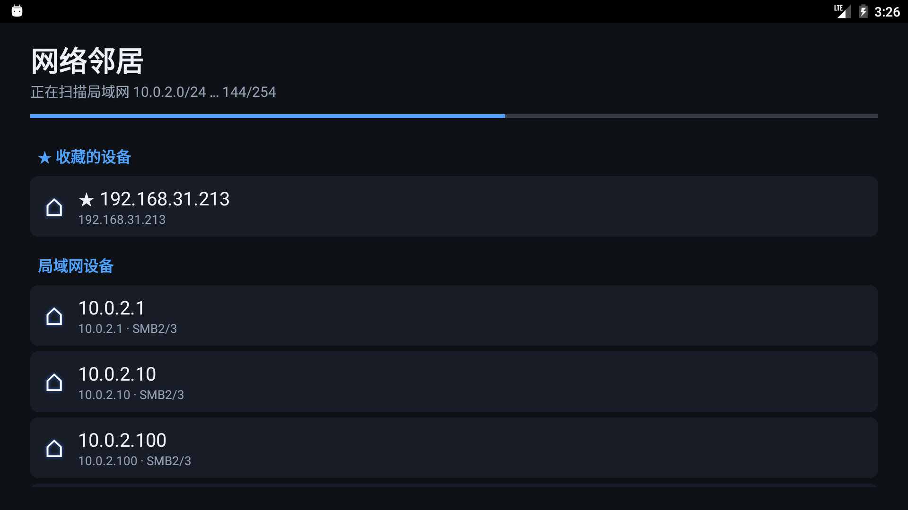
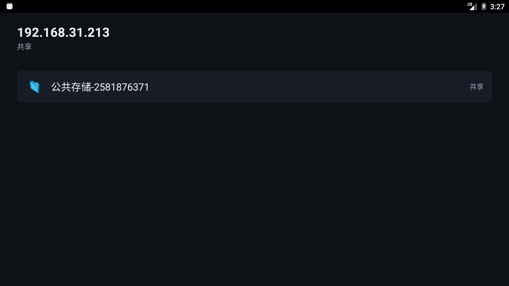
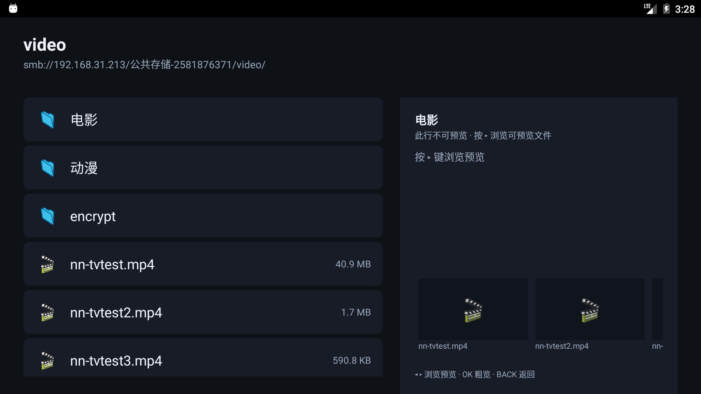
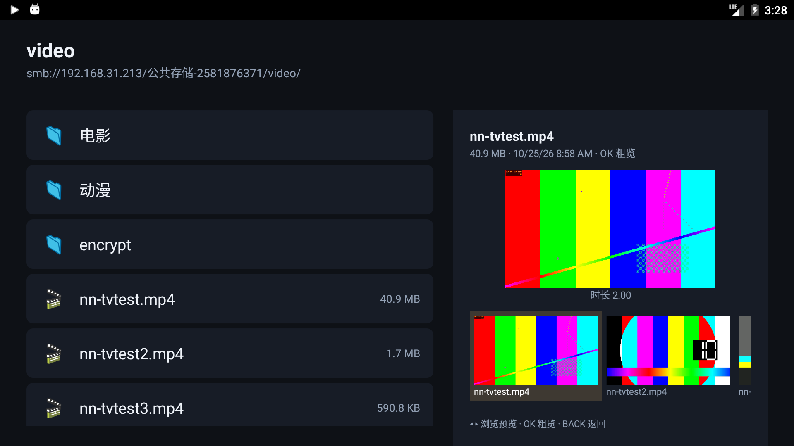
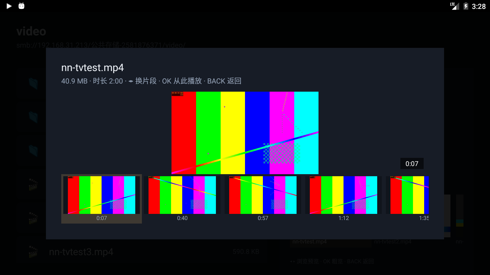
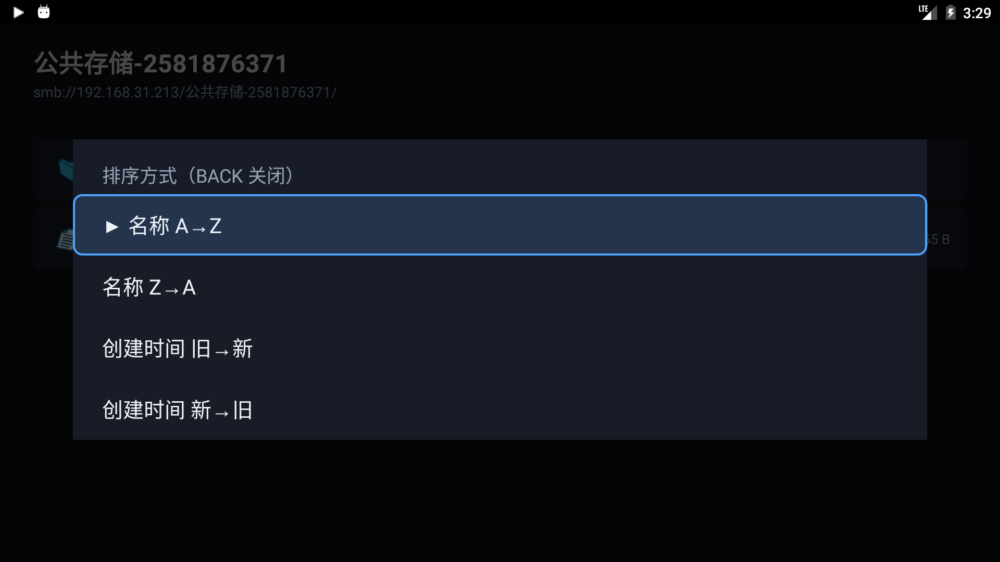

# 网络邻居（NetworkNeighbor）

为 Android 6 投影仪/电视设计的局域网 SMB（Windows 共享 / NAS）浏览与播放应用。
遥控器（D-pad）优先的 10-foot UI，不依赖厂商那个只走 SMB1 的"网络邻居"。

| 主页（445 扫描 + 收藏） | 共享列表 | 文件浏览 + 预览卡 |
|---|---|---|
|  |  |  |

| 预览条聚焦（◂▸ 进入） | 视频粗览（随机 5 片段） | 内置播放器 |
|---|---|---|
|  |  |  |

| 菜单键 · 排序方式 |
|---|
|  |

## 解决什么问题

老电视/投影仪自带的"网络邻居"基本只支持 **SMB1 + NetBIOS 浏览列表**，
而 Windows 10/11 和现代 NAS 默认禁用了 SMB1 → 表现为"**扫不到共享设备**"。

本应用：

- 发现：对所在 /24 网段做 **TCP 445 端口并发探测**（不依赖 SMB1），
  命中的 IP 再用 **NBNS Node Status（UDP 137）** 反查机器名。
  Windows 关掉 SMB1 后 NetBT 驱动仍在，Node Status 依旧能响应。
- 协议：**jcifs-ng 2.1.10**（纯 Java，minSdk 21 可用），默认协商 **SMB2.02–SMB3.1.1**；
  老设备可在"编辑凭据"里勾选"允许 SMB1"。
- 播放：**内置 ExoPlayer（Media3 1.4.1）播放页**——长按阶梯快进（10→300s）、
  45–120s 预读缓冲、512MB LRU 磁盘缓存（重看秒开）、↑键同目录切换；
  解码失败（rmvb/ape 等老格式）自动降级系统播放器，系统播放器路径走
  **127.0.0.1 回环 HTTP 流服务器**（HTTP Range → 可拖进度条），前台服务保活。
- 预览：文件行焦点悬停自动预览（防抖+帧缓存）；菜单「预览」支持图片看图、
  音视频抓帧+时长（MediaMetadataRetriever 走回环流）、字幕/文本看内容。
- **预览条（2026-10-26 新增）**：右侧预览卡底部横向轮播目录内全部可预览文件，
  焦点附近 ±2 项由单线程队列预取低清缩略图（图片降采样 / 视频回环流抓帧），
  高亮跟随列表焦点；列表态按 ◂/▸ 进入预览条（◂▸ 翻卡片、OK 粗览、BACK/↑/↓ 回列表）。
- **排序（2026-10-26 新增）**：菜单键弹出排序方式——名称 A→Z / Z→A、
  创建时间 旧→新 / 新→旧（SMB ctime），目录恒在最前，选择记忆在本地
  （SharedPreferences `nn_ui`）；重排后焦点保持在原条目，预览条态下排序不退出预览条；
  时间排序时预览卡日期跟随显示创建时间。
- **视频粗览（2026-10-26 新增）**：菜单「预览」或预览条 OK 对视频不再只抓单帧——
  随机抽 5 个时间点（分层随机，每次打开位置都不同）低分辨率抓帧成胶片轨道，
  ◂▸ 翻片段、右下角角标显示时间点，OK 从该时间点起播（PlayerActivity 收 startMs）；
  一次 MMR 会话顺序抽取、逐帧上屏，抓不到画面（纯音频/封装异常）有提示。
- 下载：复制到 `Download/网络邻居/`（Android 6 运行时权限）。
- 收藏/凭据：按主机保存（SharedPreferences，密码仅 Base64 混淆——家庭内网场景够用，别当安全存储）。

## 界面结构（参考了小米/海信系"网络邻居"的交互）

```
主页
 ├─ ★ 收藏的设备        （OK: 打开/编辑/取消收藏）
 ├─ 局域网设备          （扫描结果，实时流出；OK: 打开/收藏）
 └─ 操作：＋手动添加设备 / ⟳重新扫描
     ↓ OK
共享列表（smb://host/ 的共享，已过滤 IPC$）
     ↓ OK
文件浏览（目录优先+中文排序；菜单键=排序方式；焦点悬停自动预览；右侧预览卡带可预览文件缩略图轮播条）
     ◂/▸ 进入轮播条翻卡片 · OK 粗览（视频=5 随机片段胶片，OK 从该片段起播）
     BACK 逐级向上，共享根 BACK 回共享列表
     ↓ 文件 OK → 播放（内置播放器）
播放页（ExoPlayer 全屏）
     OK=播放/暂停 · LEFT/RIGHT 短按±10s、按住 10→30→60→120→300s 阶梯加速
     ↑/菜单键=同目录视频列表切换 · 解码失败按 OK 自动切系统播放器 · BACK 退出
```

> 固件适配注意：本机（ASU mt5873 / Android 13）Dialog 内的列表拿不到 D-pad 焦点，
> 菜单/预览/播放控制全部用 Activity 覆盖层 + 自身按键处理实现，别改回 Dialog。

## 构建

```
# 需要 JDK 17+（本机 E:\SoftDev\jdk-21.0.12.1+1）、gradle 8.9
set JAVA_HOME=E:\SoftDev\jdk-21.0.12.1+1
gradle assembleRelease
# 产物: app\build\outputs\apk\release\app-release.apk
```

- minSdk 21 / targetSdk 28（Android 6 上无 scoped storage 困扰）
- 纯 Java 实现（jcifs-ng 是纯 Java），**无 NDK 依赖 → ABI 无关**，arm32/arm64/x86 通吃

## 模拟器验证（已配置在 I 盘机械硬盘）

- SDK：`I:\Android\Sdk`（含 cmdline-tools、emulator、platform-tools）
- 系统镜像：`system-images;android-23;google_apis;x86_64`（Android 6，装在 I 盘）
- AVD：`tv23`（设备配置 tv_1080p， Television 1080p）
- 启动：
  ```
  set ANDROID_SDK_ROOT=I:\Android\Sdk
  set ANDROID_AVD_HOME=I:\Android\avd
  I:\Android\Sdk\emulator\emulator.exe -avd tv23
  ```
- WHPX 硬件加速可用（Windows 11）。

## 安装到投影仪

```
adb install -r app\build\outputs\apk\release\app-release.apk
```

投影仪是 Android 6 / armeabi-v7a → 本应用无 native 代码，直接可装。

## 已知限制 / TODO

- **jcifs-ng 对 smb: URL 不做百分号解码**（已踩坑已修，2026-10-24 真机+模拟器对
  `\\192.168.31.213\公共存储-2581876371` 验证）：共享/文件名必须原样放进 URL，
  percent-encode 会被原样发给服务器 → `STATUS_BAD_NETWORK_NAME`（"network name cannot be found"）。
  `Smb.enc()` 因此是恒等函数，别再改回 URLEncoder。
- **内置播放器（2026-10-25 新增，ExoPlayer/Media3 1.4.1）**：
  - 菜单里音视频文件多一项「播放（内置播放器）」；「播放」仍是系统播放器兜底
    （rmvb/ape 等老格式内置解不动时用它），内置解码失败页按 OK 也会自动切系统播放器。
  - 长按快进/快退：短按 ±10s，按住不放按 10→30→60→120→300s 阶梯加速。
  - 预读缓冲 45s 起、上限 120s（`DefaultLoadControl`），回退缓冲 60s；
    另有 512MB LRU 磁盘缓存（`SimpleCache`，cache 键=smb url，重看秒开）。
  - `StreamService.setPlayerActive()`：播放页在前台时 5 分钟空闲停服判定失效（暂停不掉线）。
  - 播放页不用 Dialog（本机固件 Dialog 内列表拿不到焦点），全靠 Activity 按键处理。
  - gradle.properties 的 `android.useAndroidX` 已改 true（Media3 需要；项目原为纯 Java）。
- 未做 mDNS（NsdManager `_smb._tcp`）发现通道——家用 NAS 极少广播该服务，445 扫描已覆盖。
- 未做 WS-Discovery：Amaze 的 `WsddDiscoverDeviceStrategy.kt`（res/raw/wsdd_discovery.txt）是现成参考，能给 Win11 主机显示更友好的机器名；当前 NBNS 已够用。
- 密码不是加密存储。
- 不支持 SMB over TCP 以外端口 / DFS。
- 文件名含 `?` 时 URL 会被 java.net.URL 截断成 query——Windows 文件名禁止 `?`，实际不出现。

## 服务端检查单（2026-10-24 本机审计结果）

投影仪如果要连这台 cache 盘 PC 的共享，PC 端必须同时满足（当前三条全不满足）：

1. **网络配置改为专用（Private）**：当前以太网是 Public，Windows 会拦一切入站发现/共享。
   `Set-NetConnectionProfile -InterfaceAlias 以太网 -NetworkCategory Private`
2. **启用防火墙 SMB 入站**：当前"文件和打印机共享"所有规则 Enabled=False。
   `Set-NetFirewallRule -DisplayGroup "文件和打印机共享" -Enabled True -Profile Private`
3. **建真正的数据共享**：当前只有 C$/D$ 等管理共享（要管理员账号才能进）。给媒体目录建共享并授权：
   ```powershell
   New-SmbShare -Name Video -Path "D:\Video" -ReadAccess Everyone   # 或指定用户
   # Windows 默认拒绝 guest：投影仪端用真实账号登录（本应用支持登录框）
   ```

NAS 场景无这些坑（SMB2/3 + guest/账号由 NAS 配置）。

## 目录

```
app/src/main/java/com/tv/neighbor/
  App.java              Application（进程级 Context，供播放器磁盘缓存等使用）
  MainActivity.java     主页（扫描/收藏/操作）
  ShareListActivity.java 共享列表（含认证失败 → 登录框重试）
  BrowseActivity.java   目录浏览/文件菜单/悬停预览/预览条轮播/视频粗览/图片视频字幕预览/下载
  PlayerActivity.java   内置播放器（ExoPlayer：长按快进/预读/磁盘缓存/同目录切换/降级）
  HostStore.java        收藏与凭据持久化
  SmbScanner.java       /24 段 445 并发扫描
  SmbProbe.java         SMB2 NEGOTIATE 探针（过滤 445 开着但不是 SMB 的设备）
  Nbns.java             NBNS Node Status 反查主机名（UDP 137）
  Smb.java              jcifs-ng 封装（SMB2/3 协商、枚举、MIME）
  StreamServer.java     回环 HTTP 流服务器（Range/seek）
  StreamService.java    前台服务托管流服务器（5 分钟空闲自停；播放页活跃豁免）
  DownloadTask.java     复制到本地（进度对话框）
  Ui.java               TV UI 工具（焦点缩放/覆盖层菜单/格式化）
```

工具脚本（tools/）：`test-on-emulator.sh` 装+启+截屏；`scan-port.ps1` 局域网端口扫描；
`recurse213.py`/`walk213.py` 递归列测试服务器的共享树；`gen_banner.py` 生成 TV banner。
